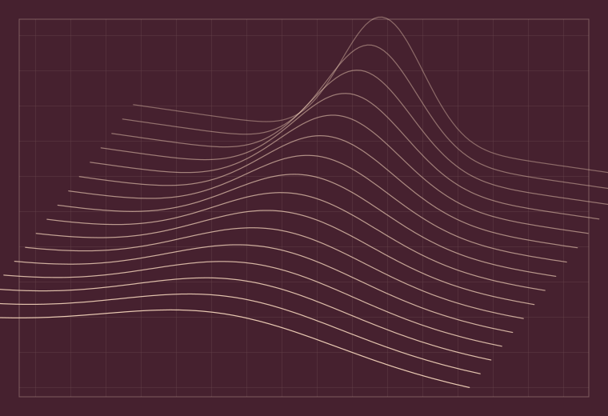
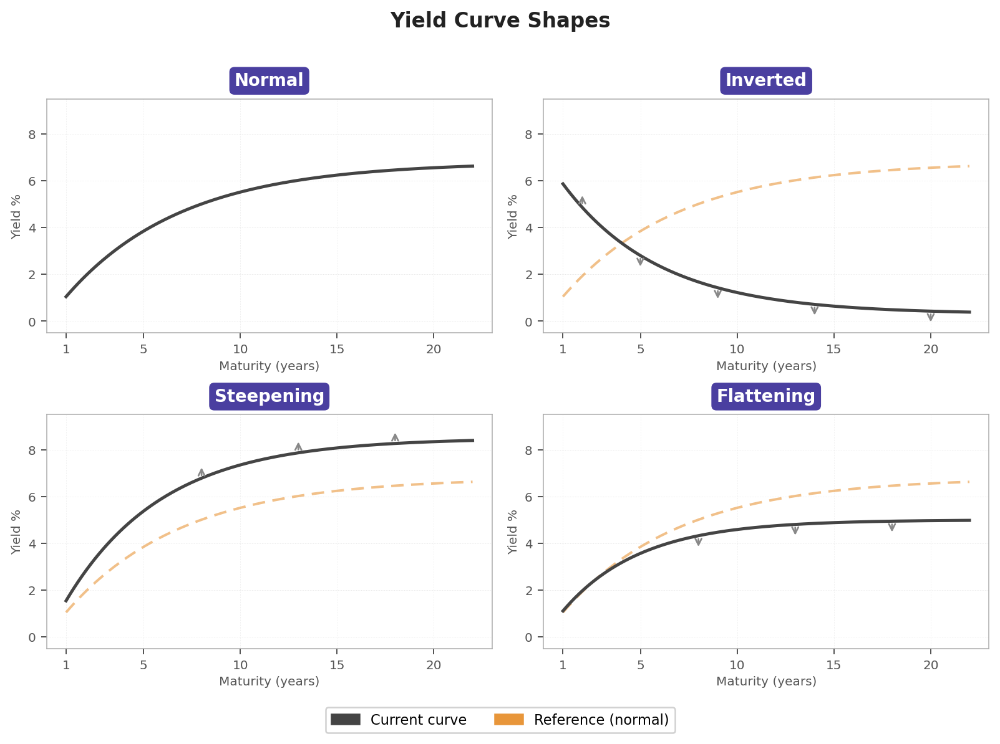
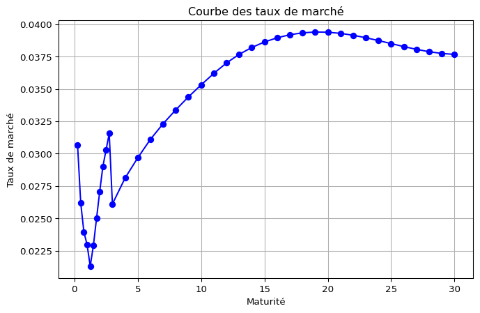

::::: {.journal-home}

::: {.journal-hero}

::: {.journal-hero-copy}

[Mathematics · Statistics · Quantitative Finance]{.journal-kicker}

# A personal research journal {.journal-display}

[Exploring mathematics, uncertainty and financial systems.]{.journal-deck}

Research notes, essays and computational explorations by Cheryl Kouadio.

:::

{.journal-hero-art fig-alt="Gaussian density curves with increasing standard deviation, shown in an oblique projection."}

:::

## Featured Writing {.journal-section}

::: {.journal-feature}

::: {.journal-feature-copy}

[Quantitative Finance · Interest Rates]{.journal-kicker}

### [Interest rates market - Key instruments](posts/finance/interest-rates/market-instruments.qmd)

From zero-coupon bonds and the term structure to forward rates and the derivatives that depend on them.

<time datetime="2026-02-14">14 February 2026</time>

:::

{.journal-chart loading="lazy" fig-alt="Four charts show illustrative normal, inverted, steepening and flattening yield curves by maturity."}

:::

## Selected Writings {.journal-section}

::: {.journal-grid}

::: {.journal-entry}

[Mathematical Foundations]{.journal-kicker}

### [Mathematical foundations of financial market modeling](posts/finance/derivatives/mathematical-foundations.qmd)

Market instruments, self-financing strategies and no-arbitrage in discrete time.

:::

::: {.journal-entry}

[Statistics]{.journal-kicker}

### [Corrélation de Spearman vs corrélation de Pearson](posts/statistics/dependence/spearman-pearson.qmd)

A comparison of rank-based and linear measures of dependence.

:::

::: {.journal-entry}

[Stochastic Processes]{.journal-kicker}

### [Calibration du modèle Black-Scholes](posts/finance/model-calibration/black-scholes.qmd)

An exploration of volatility calibration under the Black–Scholes model.

:::

:::

[Browse the writing archive](posts.qmd){.journal-link}

## Research Highlights {.journal-section}

::: {.journal-feature .journal-research-feature}

::: {.journal-feature-copy}

[Yield Curve Calibration]{.journal-kicker}

### [Modèles de courbe de taux](posts/finance/model-calibration/yield-curve-calibration.qmd)

An empirical reconstruction of a zero-coupon yield curve, followed by Hull–White calibration and a Monte Carlo application to barrier caplets.

[Explore the research](research.qmd){.journal-link}

:::

{.journal-chart loading="lazy" fig-alt="Observed rates plotted against maturity for the instruments used in the calibration."}

:::

## Explore by Topic {.journal-section}

::: {.journal-topic-index}

[Quantitative Finance](topics.qmd#quantitative-finance)

[Probability](topics.qmd#probability)

[Statistics](topics.qmd#statistics)

[Mathematical Foundations](topics.qmd#mathematical-foundations)

[Numerical Methods](topics.qmd#numerical-methods)

[Stochastic Processes](topics.qmd#stochastic-processes)

:::

## About the Author {.journal-section}

:::: {.journal-author}

{.journal-portrait loading="lazy"}

::: {.journal-author-copy}

### Cheryl Kouadio

My academic background is in stochastic modeling and quantitative finance at Université Paris Cité and financial risk management at ENSAI. I use this journal to share what I learn through coursework, projects and independent study.

[About Cheryl](about.qmd){.journal-link}

:::

::::

:::::
