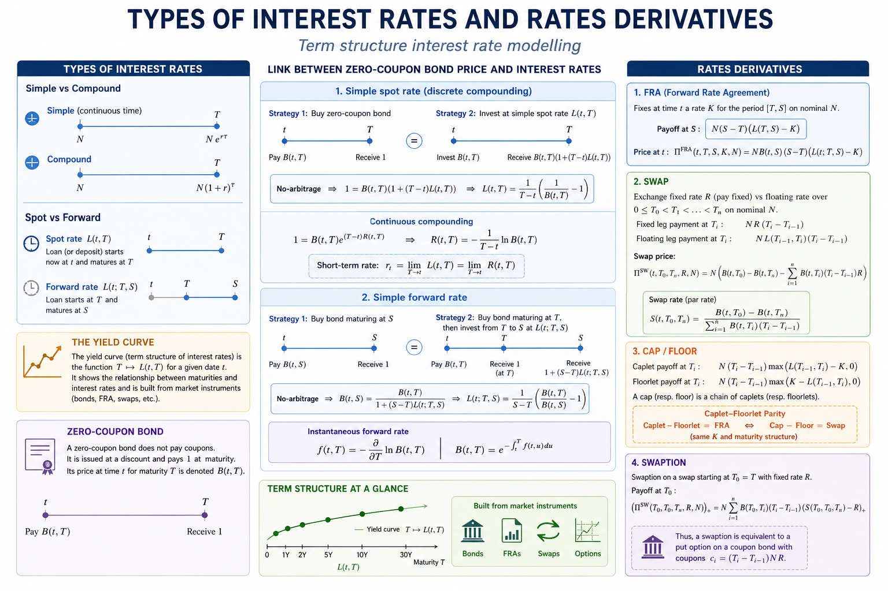

The interest rate market is one of the largest and most liquid segments of the financial markets.  
It encompasses a wide range of instruments, including government bonds, corporate bonds, interest rate swaps, and options on interest rates. The modeling of interest rates is crucial for pricing and managing the risks associated with these instruments.
To understand the dynamics of interest rates, we first introduce the different types of interest rates that are used in creating and pricing interest rate derivatives, as well as the concept of the yield curve, which is a fundamental tool for analyzing the term structure of interest rates.
Moreover, we introduce several interest rate derivatives currently traded in the market.

# Different types of interest rates

An interest rate can be seen as the cost of borrowing or the return on lending money. For example, when a counterparty A borrows at time $t$ a certain amount of cash $N$ from a counterparty B with maturity $T$ and interest rate $r$.
Then, at maturity $T$, A must pay back $N(1+r(T-t)) = N(1+r\tau)$ with $\tau = T-t$ the time to maturity, i.e. $N \mapsto N(1+r\tau)$. This is the case of a simple interest rate.

In practice, one can differentiate two types of interest rates:

- the simple interest rate. In continuous time, we write $N \mapsto N e^{r\tau}$.

- the compound interest rate. At time $t$, A borrows an amount $N$ from B with maturity $T$ and compound interest rate $r$. Then at maturity $T$, A pays back $N(1+r)^{\tau}$ with $\tau = T-t$, i.e. $N \mapsto N(1+r)^{\tau}$.

It is also important to distinguish between the different types of interest rates used in the market:

- the **spot interest rate** is the rate that applies to a loan or deposit that starts immediately and has maturity $T$.

- the **forward interest rate** is the rate that applies to a loan or deposit that starts at a future date $T$ and has maturity $S$.

# Link between the Zero-coupon bond price and the interest rates

:::{.callout-note}
# What is a zero-coupon bond?

A zero-coupon bond is a debt security that does not pay periodic interest (coupons). Instead, it is issued at a discount to its face value and pays its full face value at maturity.
If the face value is $1$, its price at time $t$ for maturity $T$ is denoted $B(t,T)$.
:::

## Link with the simple spot interest rate

Assume we pay $B(t,T)$ at time $t$ to buy a zero-coupon bond that will pay $1$ at maturity $T$. Hence, $B(t,T) \mapsto 1$ at maturity $T$.
Alternatively, we can invest $B(t,T)$ in the money market account that pays the simple spot rate $L(t,T)$. At maturity $T$, we obtain $B(t,T)(1 + (T-t)L(t,T))$.

Since we are in a no-arbitrage framework, we must have the same payoff at maturity $T$ for both strategies, which implies $1 = B(t,T)(1 + (T-t)L(t,T))$.
Hence, we deduce the following link between the zero-coupon bond price and the simple spot interest rate:

$$
L(t,T) = \frac{1}{T-t} \left( \frac{1}{B(t,T)} - 1 \right).
$$

In continuous compounding, we have $1 = B(t,T) e^{(T-t) R(t,T)}$, which gives :

$$
R(t,T) = -\frac{1}{T-t} \ln(B(t,T)).
$$

Therefore, the short-term interest rate is defined as $\lim_{T \to t} L(t,T) = \lim_{T \to t} R(t,T) = r_t$.

:::{.callout-note}
# The yield curve or the term structure of interest rates

The yield curve is a graphical representation of the relationship between interest rates and maturities. It is the function $T \mapsto L(t,T)$ for a given date $t$.
For each date $t$, we can build a yield curve using market instruments (bonds, FRA, swaps, etc.) and use it to price interest rate derivatives.
:::

## Link with the simple forward interest rate

The forward rate is the rate that can be locked at time $t$ for a loan starting at date $T$ and ending at date $S$.
To derive the forward rate from zero-coupon bond prices, consider two strategies over the period $[T,S]$, with $t \leq T < S$.

**Strategy 1: A portfolio of zero-coupon bonds**

At time $t$:

1. Sell one zero-coupon bond maturing at $T$. You receive $B(t,T)$ today and must pay $1$ at time $T$.
2. Use the proceeds to buy $\frac{B(t,T)}{B(t,S)}$ zero-coupon bonds maturing at $S$.

The initial net investment is zero. The subsequent cash flows are:

- At $T$: pay $1$.
- At $S$: receive $\frac{B(t,T)}{B(t,S)}$.

**Strategy 2: A forward lending agreement**

At time $t$, agree to lend $1$ at time $T$ until time $S$, at the forward rate $L(t;T,S)$.

This agreement requires no initial payment and generates:

- At $T$: pay $1$.
- At $S$: receive $1+(S-T)L(t;T,S)$.

**No-arbitrage condition**

Both strategies require zero initial investment and the same payment at $T$. Their payments at $S$ must therefore coincide; otherwise, taking opposite positions in the two strategies would create an arbitrage.
Thus, $1+(S-T)L(t;T,S)=\frac{B(t,T)}{B(t,S)}.$

The simply compounded forward rate is consequently :
$$
L(t; T,S) = \frac{1}{S-T} \left( \frac{B(t,T)}{B(t,S)} - 1 \right).
$$

The instantaneous forward rate satisfies $f(t,T) = -\frac{\partial}{\partial T} \ln B(t,T)$.
Moreover,$B(t,T) = e^{-\int_t^T f(t,u) du}.$

# Rates derivatives

## FRA

A FRA (Forward Rate Agreement) is a contract that fixes at time $t$ an interest rate $K$ for the period $[T,S]$ on a nominal $N$.
Its payoff at time $S$ is

$$
N(S-T)(L(T,S) - K).
$$

Its price at time $t$ is

$$
\Pi^{\text{FRA}}(t,T,S,K,N) = N B(t,S) (S-T) (L(t;T,S) - K).
$$

## Swap

A swap exchanges fixed and floating interest rates between two counterparties over dates $0 \le T_0 < T_1 < \dots < T_n$ on a nominal $N$. The fixed leg pays $N R (T_i - T_{i-1})$. The floating leg pays $N L(T_{i-1},T_i)(T_i - T_{i-1})$. The swap can be seen as a sum of FRA. Its price is

$$
\begin{align}
\Pi^{\text{SW}} (t,T_0,T_n,R,N)
&= \sum_{i=1}^n \Pi^{\text{FRA}} (t,T_{i-1},T_i,R,N) \\
&= N \left(B(t,T_0) - B(t,T_n) - \sum_{i=1}^n B(t,T_i)(T_i - T_{i-1})R \right)
\end{align}
$$

:::{.callout-note}
# Swap rate

The swap rate $S(t,T_0,T_n)$ is the rate that makes the swap price equal to zero:

$$
S(t,T_0,T_n) = \frac{B(t,T_0) - B(t,T_n)}{\sum_{i=1}^n B(t,T_i)(T_i - T_{i-1})}.
$$
:::

## Cap/Floor

A caplet (resp. floorlet) is an option that gives the right to the buyer to receive (resp. pay) the excess of the floating rate $L(T_{i-1},T_i)$ over a strike $K$ on a nominal $N$.
The caplet payoff is

$$
N (T_i - T_{i-1}) \max(L(T_{i-1},T_i) - K, 0).
$$

The floorlet payoff is

$$
N (T_i - T_{i-1}) \max(K - L(T_{i-1},T_i), 0).
$$

Hence a cap is a chain of caplets for $i = 1, \dots, n$, and a floor is a chain of floorlets for $i = 1, \dots, n$.

:::{.callout-note}
## Caplet/Floorlet and Cap/Floor parity

There exists a parity called the **caplet–floorlet parity**.

It means that a long caplet and a short floorlet with the same strike $K$ and maturity structure is equivalent to entering a payer interest rate swap with fixed rate $K$.

Mathematically,

$$
\begin{align}
\Pi^{\text{Caplet}} (t,T,T + \delta,K,1)-\Pi^{\text{Floorlet}} (t,T,T + \delta,K,1) &=\Pi^{\text{FRA}} (t,T,T + \delta,K,1).\\
 \Leftrightarrow 
\Pi^{\text{Cap}} (t,T,T + \delta,K,1)-\Pi^{\text{Floor}} (t,T,T + \delta,K,1) &=\Pi^{\text{SW}} (t,T,T + \delta,K,1).
\end{align}
$$
:::

## Swaption

A swaption is an option based on interest rate swap of maturity $T$ and fixed rate $R$. Assuming $T=T_0$ is the starting date of the swap, the payoff of a swaption is 
$$
\begin{align}
( \Pi^{\text{SW}} (T_0,T_0,T_n,R,N) )_+ &= N(1 -\sum_{i=1}^n c_i B(T_0,T_i))_+ (1)\\
&= N \sum_{i=1}^n B(T_0,T_i) (T_i,T_{i-1}) ( S(T_0,T_0,T_n) - R)_+ .
\end{align}
$$

Thus, the swaption can be seen as a put option on a classical bond with coupon $c_i$

# Take away

:::{.callout-note}
# Take away
To summarize everything covered in this article, a visual recap is provided below:

:::
