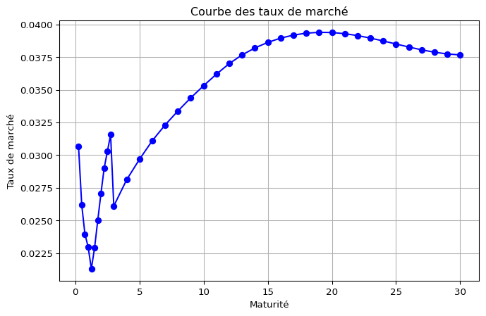

How do modeling choices affect prices and estimates of risk? These studies explore that question through calibration, simulation and numerical experiments. The [publications and reports archive](publications.qmd) includes the journal article, PDF reports and applications.

## Yield curve construction and calibration

::: {.journal-study}

{.journal-chart loading="lazy" fig-alt="Observed rates plotted against maturity for the instruments used in the calibration."}

:::{}

[Modèles de courbe de taux](posts/finance/model-calibration/yield-curve-calibration.qmd) examines how to reconstruct a zero-coupon curve from money-market, futures and swap quotes. It combines bootstrapping and cubic spline interpolation, calibrates Hull–White to at-the-money caplets and applies Monte Carlo simulation to barrier caplets.

[Read the report (PDF)](files/papers/Rapport_KOUADIO_OUYASSIN_courbes_de_taux.pdf)

:::

:::

## Numerical option pricing

The finite difference studies compare Euler and Crank–Nicolson schemes for the Black–Scholes equation and examine how early exercise changes the numerical problem.

- [European options](posts/finance/derivatives/numerical-methods/european-options.qmd)
- [American options](posts/finance/derivatives/numerical-methods/american-options.qmd)

## Volatility and filtering

These projects investigate how to estimate latent volatility and reproduce option prices.

- [Calibration avec le modèle d’Heston](posts/finance/model-calibration/heston.qmd)
- [Auxiliary particle filtering](posts/finance/model-calibration/auxiliary-particle-filter.qmd)
- [Stochastic local volatility](posts/finance/volatility/stochastic-local-volatility.ipynb)

## Dependence and tail risk

These studies examine how extreme value models and copulas can inform estimates of portfolio risk.

- [Extreme value theory](posts/finance/risk-management/value-at-risk/extreme-value-theory.qmd)
- [Copulas and multiple risks](posts/finance/risk-management/value-at-risk/copulas-project.qmd)
- [Asset Pricing and Management code repository](https://github.com/Niyo-D-JC/Asset-Pricing-and-Management)

## Published work

[Detecting the Cure Model Appropriateness in Randomized Clinical Trials With Long-Term Survivors](publications.qmd#journal-articles) explores how to assess the appropriateness of cure models for right-censored clinical trial data.
